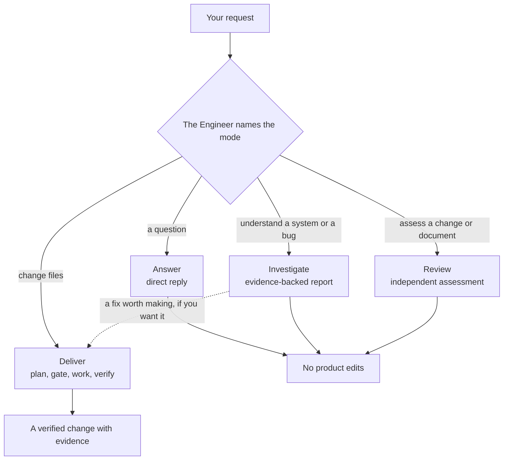
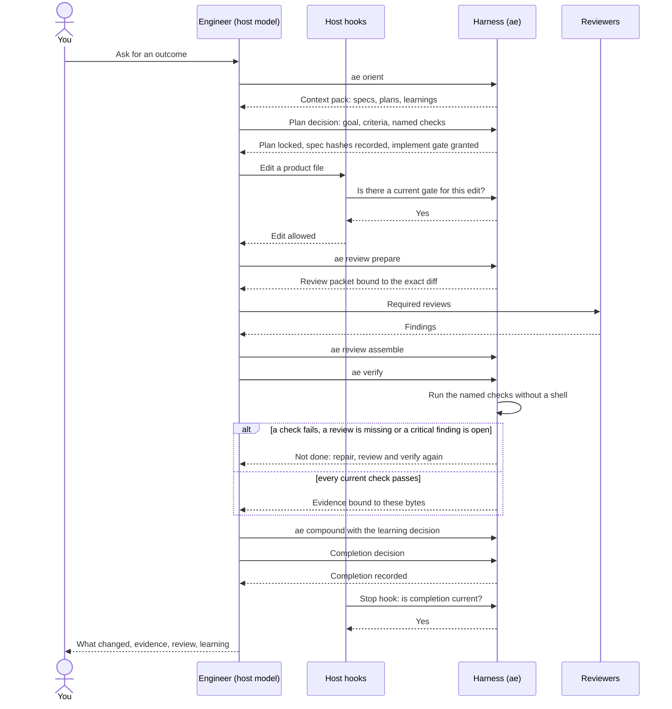
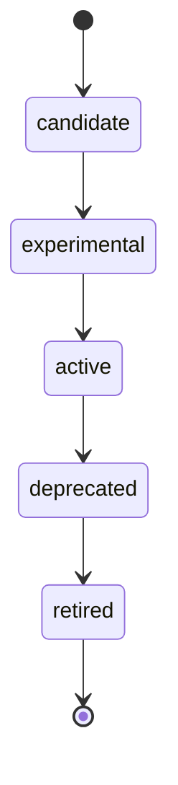
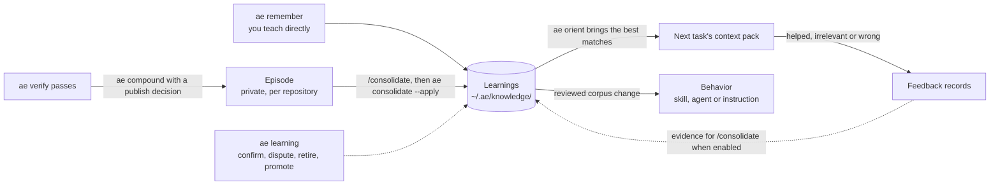

# How Adaptive Engineering works

Adaptive Engineering (AE) has two parts. The Engineer decides what to do. The Harness checks the work and keeps the record.

The Engineer is the model in your coding host, following one shared contract. The Harness is the `ae` command-line program. It never calls a model. It orients a task, locks the plan, gates edits, runs your project's own checks, records the evidence, and keeps what each task taught for the next one.

You start with those two parts and nothing else. Skills, specialist agents and scoped instructions are acquired later, when the work shows they are needed. That is the "adaptive" part: the system grows from proven work, within authority a person has granted.

For installation, see [Getting started](getting-started.md). For daily use, see [Using AE](using-ae.md).

## The Engineer

The Engineer's behavior is authored once, in [the Engineer contract](../packages/ae/corpus/skills/engineer/references/contract.md). Host setup turns that contract into each host's native format: an `engineer` skill and agent for Claude Code, Codex and Cursor, and `@engineer` for GitHub Copilot. Generated files are projections of the contract, not separate workflows.

The Engineer is the only entry point. You describe an outcome; it chooses a mode, loads the skills that fit, and delegates narrow questions to specialists when that helps.

### Task modes

Every request runs in one of four task modes. The Engineer names the mode before it starts.

| Mode | What you get | Can it edit files? |
| --- | --- | --- |
| **Answer** | A direct reply to a question. No ceremony. | No |
| **Investigate** | An evidence-backed report: what is true, how you know, how confident it is. | No |
| **Deliver** | A change, taken from intent to verified completion. | Yes, after the gate |
| **Review** | An independent assessment of a change or document. | No |

Only Deliver can change product files. A request that needs an edit switches to Deliver before the first edit, so a question never turns into an unplanned change.



## The Harness

The Harness is deterministic. Given the same plan, files and checks, it gives the same answer. It owns the things a model should not be trusted to judge about its own work:

- **Orientation.** `ae orient` builds a small context pack: relevant specs, plans, prior learnings, and the files near the change. When a resumed plan's last `ae verify` failed, or the head, plan or workspace changed since it ran, the pack lists `ae verify` with the reason right after any readiness step, so the session checks for leftover breakage before new work. A policy, trust or check change keeps it in the usual verify position, before compound, with a note to recover trust or repair checks first. Evidence that is only older than its time limit is reported as expired without reordering. This is advisory, is omitted while the gate or worktree isolation is blocked, and changes no gate.
- **The plan.** Plans are stored outside your repository, in `~/.ae/projects/<repo-id>/plans/`. The Harness writes headings, IDs, dates and progress. The Engineer supplies the decisions.
- **The gate.** Before Deliver edits a product file, the plan must be locked and an implement gate granted. Host hooks deny edits that have no gate.
- **Verification.** `ae verify` runs the checks the plan names and records the result. A missing check is not a pass.
- **The record.** Evidence, reviews, learnings and completion records are bound to the exact files they describe. If those files change, the old evidence goes stale.

## How a Deliver task runs

```text
orient → lock intent → gate → work → review → verify → compound → report
```

<details open markdown="1">
<summary>Animated walkthrough: plays three times, then shows a summary. Collapse to hide it.</summary>


</details>

1. **Orient.** The Harness gathers context, including any in-repository specs it finds (`intentSources`).
2. **Lock intent.** The Engineer writes a plan: goal, scope, acceptance criteria, and which checks prove each criterion. The Harness locks it and records a hash of each spec it depends on.
3. **Gate.** The Harness grants the implement gate. Issue work on the default branch of your main checkout is refused; `ae worktree --slug <name>` opens an isolated worktree.
4. **Work.** The Engineer edits within the plan's scope and runs focused tests as it goes.
5. **Review.** Required reviewers, such as the code-review specialists, assess the finished change. Their results are collected against the exact diff.
6. **Verify.** `ae verify` runs the named checks. Delivery passes only when current checks pass, required reviews are in, and no critical finding is open.
7. **Compound.** The Engineer decides what the task taught, if anything. A fact worth keeping becomes a learning; a detail that matters only to this task stays on the plan.
8. **Report.** The Engineer reports what changed and the evidence. The Harness records completion.

The same task as a sequence, showing who talks to whom:



The Stop hook holds the session open until completion is proven on Claude Code and Codex; on Cursor it is advisory, and the terminal host has no hooks. See [Hosts](hosts.md).

Four principles shape this loop:

- **Host-first.** The Engineer works in your editor or terminal agent, with your model. AE adds no model loop of its own on this path.
- **Kernel-always.** Orient, plan lock, gate and verify run in the Harness on every Deliver task, even when no specialist is loaded.
- **Agent-optional.** A specialist is consulted only when the task needs that judgment.
- **Benchmark-test-only.** AE also has an optional unattended agent loop (`ae agent`). It exists for measured evaluations, not for normal delivery.

### Runtime postures

- **Standalone.** The Engineer with the Harness and no acquired specialist. This is the starting point and a complete setup.
- **Degraded.** A missing check, index or tool is reported as missing, never invented.
- **Governed.** A learning that a person has confirmed. Governed learnings are reapplied across rebuilds.
- **Bounded delegation.** A specialist receives a narrow question with only the context it needs, and returns an answer. It does not take over the delivery. Required independent review stays separate from whoever wrote the code.

## Plans, checks and trust

### What a plan must contain

A plan states its intent sources, its verification and its required reviews. New full plans use `plan_schema: 2`; short plans use `short-v2`. Older `plan_schema: 1` and `short-v1` plans stay readable with their original guarantees.

```yaml
plan_schema: 2
intent_source_policy: content-v1
intent_sources: []
verification:
  required: [behavior]
  criteria: {AC1: [behavior]}
reviews:
  required: [code-review]
  completed: []
  critical_open: []
```

Each acceptance criterion maps to the checks that prove it. A plan with no accepted named check stays an unlocked draft. Under `content-v1`, editing a locked spec invalidates the gate and the proof until someone explicitly accepts the new text. If shipped behavior contradicts a spec, update the spec in the same change rather than silently rewriting it from the code.

The full plan, review and evidence contract is in [Plans, gates and proof](reference/plans-and-proof.md).

### Named checks

Checks are the commands that prove behavior: your test suite, a linter, a build. They are declared once per project as argv arrays, for example `command: ["npm", "test"]`, and the Harness runs them without a shell. Plans refer to checks by name. A plan cannot smuggle in a new command.

You do not write check files by hand. The Engineer reads your project's test setup and proposes checks through `ae checks configure`. Policy exemptions and waivers are explicit entries in the project policy, never implied.

### Trust

Before any project-defined command runs, a person approves the project's policy and checks with `ae trust approve`. Approval is stored per person and per machine, and it is bound to the exact bytes of the policy files. If someone changes a check command, approval is withdrawn until it is reviewed again. Installing AE, passing a health check, or cloning a team's configuration never grants trust.

Project configuration is private by default, under `~/.ae/projects/<repo-id>/authority/`, so nothing new appears in your repository. `ae init-repo --shared` writes it to `.github/harness/` instead, for a team to review and commit. See [Project setup and trust](reference/project-setup.md).

### Enforcement modes

Host hooks apply the project policy's enforcement mode:

| Mode | Effect |
| --- | --- |
| `enforce` | Edits without a gate are denied. This is the default. |
| `warn` or `observe` | The hook records the decision, explains what is missing, and allows the edit. The two values currently behave the same. |

The `HARNESS_ENFORCEMENT` environment variable overrides the policy for one process. Hooks also recognize a bounded set of read-only terminal commands. Scripts, package commands and ambiguous shell syntax are treated as opaque: they need a fresh gate and must match a named check in the locked plan.

## How capability is acquired

Skill-first: a repeated procedure becomes a skill before it becomes another agent. The Engineer can start with no domain skill and no specialist; those are acquired later.

| Need | Becomes |
| --- | --- |
| A procedure you repeat | A skill |
| A judgment that needs its own reviewer, permissions or isolation | An agent |
| A rule for one kind of file | A scoped instruction |
| A narrow review criterion | A check |
| A solved problem worth recalling | A learning |

Setup first inventories the skills, agents and instructions you already have and asks which sources to include, then asks separately whether ongoing discovery is allowed. Those choices, with any exclusions and scoped standing grants, are stored outside the product checkout. Project content cannot broaden them.

When a task needs something the catalog lacks, the Engineer does one bounded refresh if discovery is allowed, then reuses, acquires or reports the gap. A specialist the task needs, such as a missing independent reviewer, can be acquired on first need: `/ensure-capability` records the gap and `/create-primitive` creates the smallest separate role. That needs direct authorization or a current standing grant that covers it; anything outside that scope goes back to a person. A repeated procedure becomes a durable skill only with verified promotion evidence.

<details open markdown="1">
<summary>Animated walkthrough: plays three times, then shows a summary. Collapse to hide it.</summary>


</details>

An internal `decision-agent`, running in the host on a small model where the host allows, judges exact actions and readiness. It cannot grant trust or user authority, and neither a model verdict nor a recurrence count can authorize a merge. After internal review, repair and passing verification, `ae review tour` gives the person a source-linked tour of the change for final review. See [Adaptive capability lifecycle](reference/capability-lifecycle.md).

A capability moves through five states: candidate, experimental, active, deprecated and retired. Promotion to active needs a trigger eval (it activates when it should, and not when it should not), an outcome eval (using it produces better results), and recorded promotion evidence. Retirement leaves a tombstone, so a later task can see the overlap with whatever replaced it, and upgrades remove retired files.



The registry of shipped capabilities and their states is [capability-registry.yaml](../packages/ae/corpus/knowledge/capability-registry.yaml).

## How knowledge compounds

Knowledge has three tiers. Each tier has a single writer.



1. **Episodes.** After `ae verify` passes, the Engineer records what the task taught as a private solution episode in `~/.ae/projects/<repo-id>/docs/solutions/`. An episode can cite the one failing line of check output that showed the lesson (`evidence_quote`, a single line of up to 600 bytes). Harness never stores or shows that line: it keeps only a fingerprint, the SHA-256 of the line after normalisation (a leading byte-order mark and terminal escape sequences removed, Unicode NFC applied, both ends trimmed), plus its length. The line is accepted only on stdin, never in argv: pipe it to `--evidence-quote -` from a command that never names it (for example `sed -n '<N>p' <check-log>`), run in the host shell rather than through `ae bash`, `ae exec` or the TUI `!`, or put it in a learning decision piped to `--learning-decision -`; Harness refuses an evidence line from a decision file. `/consolidate` sees the fingerprint prefix and length, and confirms the evidence by re-running the check and matching its output with `ae compound --match-evidence <prefix> --evidence-bytes <bytes> --check-output <file>`. `ae remember` records something a person teaches directly. Episodes never leave your machine on their own.
2. **Learnings.** `/consolidate` clusters episodes into learnings, stored in a local Git repository at `~/.ae/knowledge/<repo-id>/`, outside your working tree. Only `ae` commands write that store: `ae consolidate --apply` and `ae remember` add learnings, and `ae learning` changes their status. `ae orient` injects the best-matching learnings into the next task's context.
3. **Behavior.** A pattern that should change how every task runs becomes a skill, agent or instruction, through a reviewed change to the corpus.

### Feedback on recall and review

AE records which learnings each context pack delivered for a plan. When the work finishes, the learning decision can say whether each one `helped`, was `irrelevant` or was `wrong`, and whether each review finding was `fixed` or `dismissed`. Harness checks every ID against what the plan actually saw and writes the verdicts to an immutable record in `~/.ae/projects/<repo-id>/feedback/`, so verdicts from every worktree reach consolidation. Each disposition carries Harness's own observation of whether the latest review still reports the finding, and the record cites the decision agent's latest readiness receipt for the plan, so outcomes can later measure how well that agent judged readiness.

That citation comes from a per-plan readiness index that decision compaction keeps in the decision archive. When an index write is refused or the index can't be read, the receipt still archives and the plan is noted, and `ae resources decision` with `operation: "status"` reports a `readiness-index` warning. The warning says which plans' indexes may name an older receipt than the newest one archived. It can also count plans that may be stale but are no longer tracked one by one, along with how far reconciliation has got. Feedback records for a noted plan cite its newest archived receipt; for a plan that is only counted, not yet reconciled, the citation may name an older receipt until the warning clears. Status is read-only: it only reports the warning. Retrying noted index writes and reconciling untracked plans from the request archive, at most one bounded slice every 30 seconds, happen only on decision `prepare` and `record`. Guarded tool calls never do either. The warning clears once every noted plan's index holds its newest receipt and a full sweep finishes with no unreadable record and no refused write.

The index is derived from the request archive, so AE rebuilds it rather than keeping a bad copy. The exception is an index written by a newer AE version: it is kept and never rebuilt over, its plan stays noted, and citations use the noted receipt. An index file that reads but holds no valid index, such as an empty or truncated file left by a crash, is replaced with the receipt at hand, and its plan is counted until a fresh sweep has checked it against every record. The same goes for a request record that the index or a note names: if it reads but proves nothing, because it is empty, truncated or fails its hash, the index is rebuilt from the receipt at hand and the sweep names the record. A read that fails, such as `EMFILE`, `EIO` or `EACCES`, keeps the file and is retried later.

**Durability.** A problem with an archive file never makes compaction fail a decision operation. Request records, task budget records and index files are flushed to disk before they are published where the filesystem allows it. A request or task budget record whose flush fails for any reason is published unflushed. An index file is published unflushed on a filesystem that cannot flush; any other flush failure, such as `EIO`, refuses that index write, which is noted and retried like any other. The directory is not flushed after a record is linked or renamed into place, so a crash soon after a pass can still lose a just-published record. That is a known residual.

**Crash-left records.** If a crash leaves the name of a request that is still live holding an empty or partial file, the next archive of that request replaces it with the verified record, and the plan is counted until a fresh sweep has checked it. A record left that way for a request that is no longer live is never replaced, because nothing live can rebuild it. A lookup of that request by `status`, `record` or a repeated `prepare` names the file: `status` reports it in an `archive` warning and shows the request as missing, and `record` and `prepare` refuse. The same applies to a symlink or other non-regular entry at its name. Restore the record from a backup, or move it out of the archive. The request then reads as unknown: `status` reports it missing, `record` refuses it, and preparing the same input again starts it fresh under its task's remaining budget. A task budget record left empty or partial yields to the live copy of the task, if there is one, and is then replaced. Without a live copy the budget can't be verified, so it fails closed: `prepare` and `record` refuse with an error that names the `tasks/` file, and `status` reports it. Restore the file from a backup, or delete it, which resets that task's budget.

**Archived requests are read-only.** A retained request record is never overwritten. If it differs from the live copy only in when the receipt was consumed, and it already records a consumption, it stands and the live copy retires. A request looked up from the archive, for example by `status`, `record` or a repeated `prepare`, is read-only evidence. `record` replays its receipt if it has one and refuses if it has none; prepare a new request instead. The next compaction drops it, and the task budget the lookup brought in, from the live state without writing either back. It refreshes the plan's readiness index only from the archived record's own receipt. A decision-agent observation or child spawn for a request that is already archived, or whose task time budget has expired, is refused.

**Records that can't be archived.** When a request or task budget is due to retire but its record can't be archived, it stays in the live decision state. Causes include:

- a read that fails now;
- a record over 2 MiB, which is never read or replaced;
- a regular file where a directory on its path belongs;
- a refused write, or a directory that can't be created;
- a symlinked directory on its path;
- a symlink or other non-regular entry at its name;
- a record written by a newer AE version;
- a valid retained record that disagrees with the live copy.

Each of these leaves an `archive` warning in `status`, with the number of records held live and up to eight files, each with its reason and remedy. An entry at the name of a request that is not yet due to retire isn't looked at, so it is reported only once the request is due. While the warning stands, decision `prepare` and `record` retry those records at most once every 5 seconds. Any pass, guarded tool calls included, retries them while the live decision state is over 512 KB, because such a state compacts on every pass. Otherwise guarded tool calls don't retry them. A record archives on the first such retry after you fix the cause. Until then the live state keeps growing. If it fills, decision operations fail with an error that names these records, instead of telling you to wait for budgets to expire. `status`, `prepare` and `record` report a task budget record that can't be used the same way, and `prepare` and `record` refuse until it is fixed, because the budget can't be verified. A lookup of an archived request whose record can't be used makes `prepare` and `record` refuse with the matching remedy, and `status` report it. For example, a regular file might stand where the `requests` directory belongs.

**Sweep warnings.** Some states don't clear on their own. The `readiness-index` warning names the files involved, by archive-relative name under the archive path it prints, up to eight at a time, and says "(first N)" when it found more. Each file is listed with the reason it couldn't be used, and the remedy for that reason:

- An index file that is a symlink or not a regular file is never followed or replaced. Remove it, and the next `prepare` or `record` rebuilds it.
- An index file written by a newer AE version is kept and not used. Use that version, or remove the file, and the next `prepare` or `record` rebuilds it.
- An index file that couldn't be read or written, for example because of its permissions or because the `readiness` directory is a symlink, is kept. Make the file and a real `readiness` directory readable and writable, or remove the file, and the next `prepare` or `record` rebuilds it.
- If the archive's `requests` path is a regular file, a symlink or otherwise not a readable real directory, no sweep can list it. Make it a real, readable directory.
- An archived request record written by a newer AE version, or larger than 2 MiB, is kept and not used, and stops every sweep from finishing clean. Use that newer version, or move the record out of the archive; it can then no longer be looked up by ID.
- An archived request record that can't be read or proves nothing, including one that is a symlink or not a regular file, stops every sweep from finishing clean. An entry at the name of a request that is still live is skipped here; the `archive` warning reports it. This includes a record whose failed read stops an index write. Make it readable, restore it from a backup, or move it out of the archive if it can't be restored; that request can then no longer be looked up by ID.
- An archive with more than 65,536 request records is more than one sweep can list, so no sweep can complete. Move request records you no longer need to look up by ID out of the archive's `requests` directory.

`ae knowledge feedback <off|suggest|on>` controls who reads those records. `off`, the default, only records them. `suggest` shows them to `/consolidate` as evidence, including learnings judged wrong in their current form and each reviewer's fixed and dismissed counts. `suggest` also adds `exposed`, `helped`, `wrong` and `last_exposed` columns to `ae knowledge status`, `ae knowledge --status` and `ae learnings`, and `ae doctor` reports learnings exposed five or more times without a single `helped` verdict as an advisory pruning hint (K8). An exposure is one context pack that delivered the learning, so the count is of `ae orient` runs, not distinct plans. Exposure counts are summed over the plans in the current worktree, because exposure records live there; exposures recorded in other worktrees, or under a domain parent's record root, are not counted. Counts are lower bounds: each plan's record keeps its 64 most recent (learning, layer) entries, and an entry evicted and delivered again starts counting from one. Each entry counts one learning in one layer, credited to the layer whose line the pack rendered, so a branch twin's exposures don't count for the golden learning; when a pack renders both the golden line and its twin's line, only the golden is credited. Branch-layer counts are not tied to a branch bucket: after switching branches, a branch learning with the same ID inherits the earlier branch's count. Verdicts come from the project store, cover every worktree and are tallied over the full history. Status rows list learnings with any exposure or a `helped` or `wrong` verdict; `irrelevant` verdicts appear only in the `/consolidate` packet. `on` also lets an unresolved `wrong` verdict make consolidation due, and orders the `/consolidate` packet's learnings with `review_required` first, then learnings with any `wrong` verdict, then the most exposed. Under `off` every one of these outputs is byte-identical to a release without feedback. No state grants authority: feedback never retires, disputes, confirms or promotes a learning. Knowledge modes `off`, `freeze` and `capture-only` read feedback as `off`.

### Re-checking learnings

`ae consolidate --candidates --recheck` asks `/consolidate` to re-check active learnings against later evidence. It reads only Harness records: exposure records, verification evidence, the run journal, review observations, feedback records and the learning store. It never reads host transcripts, because they are not authenticated. The `recheck` section lists exposed learnings whose source bindings changed, learnings judged wrong in their current form, named checks (from `checks.yaml`, not Harness's own gate rows) or commands that failed in at least two plans, review findings that recur by perspective and file across at least two plans, and learning bodies that cite a learning or path that no longer exists. Each list is capped at 10 entries with omission counts. No raw check output or finding title text is shown: a failure cluster lists each failing record's sanitized check name, status, exit code, signal, timestamp, stdout and stderr line counts and a short output hash, with a hint to re-run the check to see its output, and a finding cluster shows only title hashes, severities and lines. Identity fields are shown only when an allowlist vouches for them: a check name only when the workspace's checks configuration declares it, a run-journal command only when it is a command the `ae` command registry defines, a finding category only when it is a review perspective Harness defines, and a finding file or plan only when it is an existing file in the checkout or the project's plan store. Anything else shows as a short digest, however safe it looks. Evidence record paths are not listed, because the records hold retained output. A plan in the project's external plan store is shown by its file name, which `ae verify --plan <name>` accepts, so the home directory never appears. Timeouts count as failures. A check killed by a signal is recorded `unavailable` and never clusters. Finding clusters are informational: they never make consolidation due, no answer clears them, and their `finding-cluster:<id>` IDs are refused by `--derived-from`. Past 4,096 entries in a record directory the scan is a sample, reported in `omitted.directories`.

A cluster is evidence, not an episode. To turn one into a learning, the agent captures an insight with `ae compound --insight --derived-from failure-cluster:<id>` and cites it in an ordinary ADD or STRENGTHEN, so `ae consolidate --apply` stays the sole writer and the learning names the cluster it answers. The cluster ID names the failing check, not specific records: when an ADD, STRENGTHEN, SUPERSEDE or MERGE consumes the insight episode, apply records the answer and its time on the knowledge ledger, whatever the `knowledge.recheck` setting. The cluster then clears in every branch, whatever branch recorded the answer, and stays cleared if the episode file is later edited or deleted. `ae knowledge purge` of that episode removes its ledger entry too, so the cluster reopens. A failure timestamped after the answer, the same day included, also reopens it. A NOOP does not answer a cluster. To see a failure, the agent re-runs the check as the cluster's hint says; it does not read evidence records or run output.

`ae knowledge recheck <off|suggest|on>` controls who reads re-check signals. `off`, the default, leaves packets and status byte-identical. `suggest` lets `--recheck` add the section; status names the state, and due is unchanged. `on` also scans on each status, computing only what decides due (stale exposed learnings and named-check evidence clusters among the newest 128 evidence records by modification time; the packet reads more as context, but only that window decides due, so status and the packet agree), and makes consolidation due when three exposed learnings have stale bindings or one named-check failure cluster spans three plans. Run-journal clusters are context only, because a failed run cannot tell a gate refusal from a broken check. No state grants authority, and knowledge modes `off`, `freeze` and `capture-only` read re-check as `off`.

A person can confirm, dispute, retire or promote a learning with `ae learning`. The governance ledger records each decision and reapplies it when learnings are rebuilt. Episodes from unverified investigation (`ae compound --insight`) stay separate and are never promoted automatically.

## Where state lives

| What | Where |
| --- | --- |
| Host integration (skills, agents, hooks) | The host's configuration directory, for example `~/.claude`, `~/.codex` or `~/.cursor` |
| Plans, private configuration, solution episodes | `~/.ae/projects/<repo-id>/` |
| Learnings | `~/.ae/knowledge/<repo-id>/` |
| Knowledge search index | `~/.ae/index/<repo-id>/knowledge/` |
| Trust approvals | `~/.ae/trust.yaml` |
| Recall and review feedback records | `~/.ae/projects/<repo-id>/feedback/` |
| Runtime evidence for one checkout | `.harness/` in the checkout, excluded from Git |
| Shared team configuration (optional) | `.github/harness/` in the repository |

`--ae-home <path>` selects a different root for one command; `AE_HOME` sets it for every command. The state home must be outside the product checkout. Every checkout maps to one repository ID: the normalized `origin` remote, or the path of the main worktree when there is no remote. Linked worktrees share it.

## What AE does not claim

- **Native host behavior is not proven by setup.** `ae host setup` reports `nativeQualification: unverified`. Configured hooks and passing fixtures do not prove that a particular host version loaded them or blocked a real edit. Qualify the host, version and OS you rely on.
- **Hosts differ.** Claude Code and Codex can block completion from a Stop hook; Cursor's stop follow-up is advisory. The terminal host has no hooks. See [Hosts](hosts.md).
- **Checks prove what they test.** A passing verify means the named checks passed on these bytes. It does not judge whether the checks are adequate; that judgment belongs to the Engineer and its reviewers.
- **No model-quality numbers here.** Mechanical tests cover the Harness. Comparative model outcomes need their own evaluation and are not claimed in these docs.

## Reference

Detailed contracts for each part of the system:

| Page | Covers |
| --- | --- |
| [Project setup and trust](reference/project-setup.md) | `init-repo`, private and shared configuration, trust, named-check recovery, repository IDs |
| [Plans, gates and proof](reference/plans-and-proof.md) | Plan schemas, structured workflow, reviews, evidence, terminal hooks, worktrees, playbooks |
| [Product verification](reference/verification.md) | Verification recipes, formal checks, workflow invariants |
| [Context and recovery](reference/context.md) | Context packs, expandable context, post-merge recovery, recovery ownership |
| [Structural knowledge](reference/structural-knowledge.md) | `ae graph`, impact analysis, structural indexes |
| [Workspace binding](reference/workspace-layout-detection.md) | Monorepos, multi-repository tasks |
| [Domains](reference/domains.md) | Delivery across several repositories |
| [Flow models and diagrams](reference/flows.md) | Descriptive application maps, local diagram rendering |
| [Performance analysis](reference/performance.md) | Journey-based performance reports |
| [Bounded experiments](reference/experiments.md) | Measured, budgeted optimization attempts |
| [Adaptive capability lifecycle](reference/capability-lifecycle.md) | Discovery consent, acquisition, the decision-agent, approval tiers, review tours |
| [Model preferences](reference/model-preferences.md) | Choosing a model per role |
| [CLI reference](../packages/ae/README.md) | Commands, exit codes, packaging |
| [Harness tool contract](../packages/ae/corpus/skills/references/harness-tool-contract.md) | The exact CLI contract the Engineer follows |
