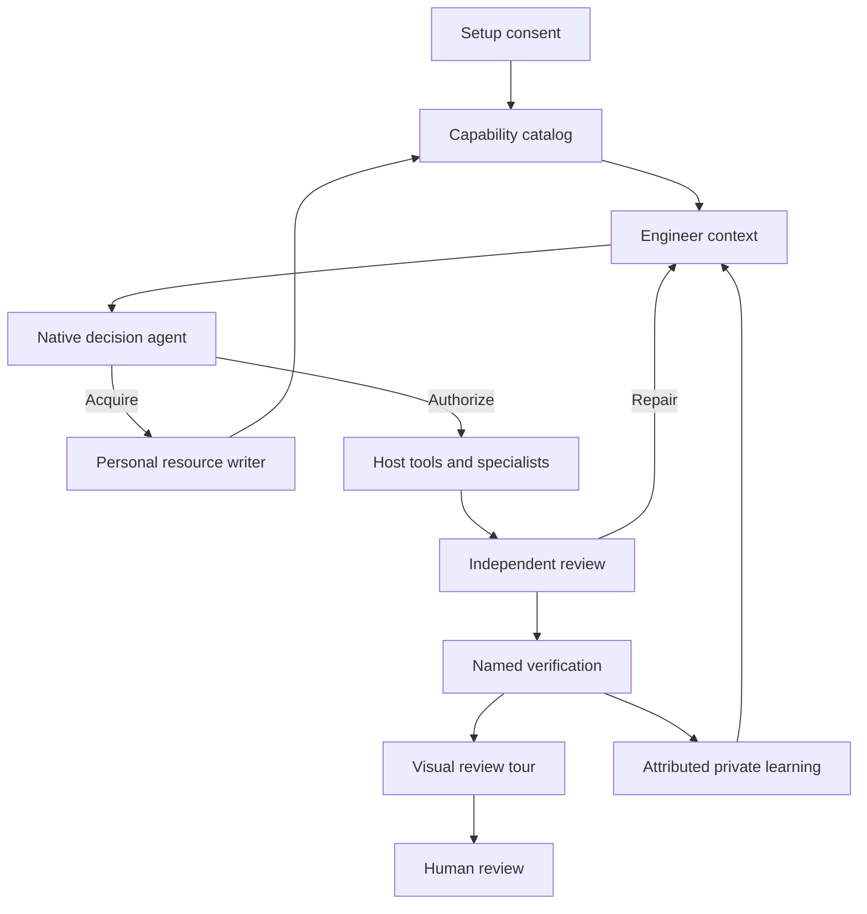

# Adaptive lifecycle: human review tour

## Problem and behavioral change

Previously, resource registration, routing, host projection, review provider lookup, and learning recommendations used separate inventories. Required reviewers were loaded by bundled filename, native personal agent/instruction creation was unmapped, and recurrence candidates were not carried into ordinary task context. A reduced corpus could therefore expose missing-file dependencies instead of a usable acquisition path.

The implementation retains the complete shipped corpus and adds a consented adaptive path. Existing installations keep their legacy behavior until discovery is configured. New setup returns two inclusion/ongoing-discovery questions. Configured tasks receive bounded included capability cards and recurrence evidence; missing providers produce explicit acquisition prerequisites. Native decision agents supply judgments through the host's agent tools, with no new inference API. Kernel receipts bind those judgments to source, consent, task budget and actual recorded adapter observations. The human receives reviewed code, verification and a current visual tour.

## Application context

This is a source-backed descriptive view. It is not an explored TLA+ state graph or proof of native host enforcement. Host hooks, effective permissions and loaded model/role versions remain separate qualification surfaces.

## Workflow ownership at the capability boundary

The reconciled change preserves the workflow ownership and recovery behavior already on `main`. A newly observed user turn stays pending until a successful revision-bound plan decision reconciles it. An exact native action approval cannot accept that turn, write a managed plan directly, or replace verification. Native hooks retain both prompt observation and specialist/decision completion observation.

Engineer can author a closed `observedIntent` description in its bounded JSON input before the product gate. That is data preparation: the plan consumer still validates the actual observation, current plan revision and permitted disposition. Source inclusion, tool approval, intent acceptance and readiness remain separate evidence.

For this boundary, read [host-intent.mjs](../../packages/ae/lib/host-intent.mjs), [decision-staging.mjs](../../packages/ae/corpus/hooks/lib/decision-staging.mjs), [plan-decisions.mjs](../../packages/ae/lib/plan-decisions.mjs) and [native-hook.mjs](../../packages/ae/lib/hosts/native-hook.mjs). Existing linked-worktree authority and post-merge compounding recovery also remain in place; recovering an old plan does not manufacture current independent review or native loading proof.

## Read the change in behavior order

1. [capability-catalog.mjs](../../packages/ae/lib/capability-catalog.mjs): `configureDiscovery`, `discoverCapabilities`, `adoptCreatedCapability`. Review user-only state, inclusion versus ongoing refresh, source/version guards, excluded roots, permission expansion, inherited host authority, bounded negative refresh and revocation. [Catalog tests](../../packages/ae/test/capability-catalog.test.mjs).
2. [adaptive-context.mjs](../../packages/ae/lib/adaptive-context.mjs) and [orientation-facts.mjs](../../packages/ae/lib/orientation-facts.mjs): task-specific capability cards, omissions and recurrence recommendations. [CLI integration tests](../../packages/ae/test/adaptive-integration.test.mjs).
3. [decision-agent.mjs](../../packages/ae/lib/decision-agent.mjs): prepare native judgment packets, observe actual adapter events, record and consume exact-action/content-bound receipts, rederive readiness and share budgets across task labels. [Decision tests](../../packages/ae/test/decision-agent.test.mjs).
4. [personal-resource.mjs](../../packages/ae/lib/hosts/personal-resource.mjs), [personal-authorization.mjs](../../packages/ae/lib/hosts/personal-authorization.mjs) and [native-specialist-observation.mjs](../../packages/ae/lib/native-specialist-observation.mjs): source validation, mapped publication, consent-race rollback and approved delegation reconciliation. Initial consent, an explicit `resources discover --refresh`, and host upgrades reconcile eligible selected-root roles without treating publication as loading. A generated role starts pending reload; an exact approved first-invocation probe and correlated native completion can establish availability for that source. Cached host source loading remains unverified. [Upgrade/refresh tests](../../packages/ae/test/host-upgrade-delegation.test.mjs), [native writer tests](../../packages/ae/test/host-personal-resource.test.mjs) and [observer tests](../../packages/ae/test/native-specialist-observation.test.mjs).
5. [review-preparation.mjs](../../packages/ae/lib/review-preparation.mjs), [review-synthesis.mjs](../../packages/ae/lib/review-synthesis.mjs) and [review-tour.mjs](../../packages/ae/lib/review-tour.mjs): provider binding, actual packet-bound full native response matching, rejected adaptive self-review and authored-only invocation claims, exact code links, rendering and stale artifact refusal. [Provider tests](../../packages/ae/test/review-portability.test.mjs) and [tour tests](../../packages/ae/test/review-tour.test.mjs).
6. [skill-provenance.mjs](../../packages/ae/lib/skill-provenance.mjs), [compound.mjs](../../packages/ae/lib/compound.mjs) and [resource-recurrence.mjs](../../packages/ae/lib/resource-recurrence.mjs): included source-bound reads, explicit/inferred authority, native judgment over exact private memory content/destination/proof, retained verified evidence and distinct-task recurrence. Loading evidence is not causal effectiveness. [Publication tests](../../packages/ae/test/memory-decision-publication.test.mjs), [attribution tests](../../packages/ae/test/adaptive-memory.test.mjs) and [recurrence tests](../../packages/ae/test/resource-recurrence.test.mjs).
7. [Installed lifecycle evaluation](../../packages/ae/eval/adaptive/lifecycle.mjs): full versus reduced workflow closure versus a four-skill bootstrap; absent optional roles, actual workflow acquisition/source reads, behavioral negative control, cross-process persistence, native observer fixtures, internal review/tour/verification/readiness and memory continuity. [Evaluation limits](../../packages/ae/eval/adaptive/lifecycle.md) distinguish contract fixtures from live model/editor qualification.

## Review questions and residual limits

- Can any discovered file, authored `approved` field, alternate task label, or changed source expand existing authority or reuse an old receipt?
- Does a newly acquired provider retain its pending activation state through catalog, delegation and review selection?
- Does missing, stale, excluded, oversized or omitted evidence remain visible rather than becoming a clean readiness result?
- Does private recurrence remain justified after the original worktree's runtime evidence is removed?
- Configuration and deterministic native event fixtures do not establish live editor/model invocation, independence or all-host enforcement. Ready-for-human status does not merge, publish a release or grant new tool authority.

The PR and audit record carry observed check results. The final renderer receipt binds this view to selected source bytes; a later fix requires refreshing the affected tour before acceptance.
