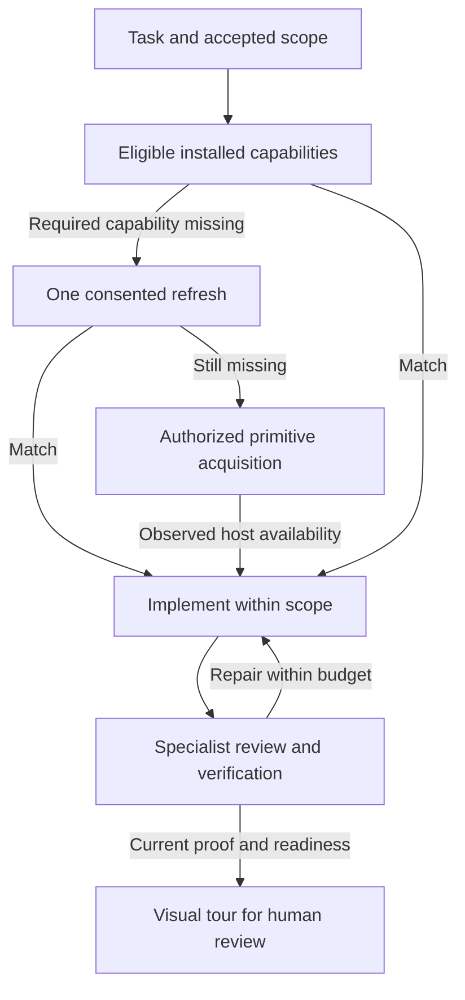

# Adaptive capability lifecycle

How the Engineer discovers, acquires and promotes capability, how internal decisions and approvals work, and how a verified change is handed to a person for review. For the overview, see [How capability is acquired](../adaptive-engineering.md#how-capability-is-acquired).

Setup first inventories the user's existing skills, agents, and instructions in selected host roots and asks which sources to include. It then asks separately whether ongoing discovery is allowed. `ae resources discover --file - --json` records the user-owned inclusion policy, exclusions, automatic adoption/update choices, and scoped grants. Configuration updates use the prior revision. Project content and discovered resource prose cannot broaden consent. Selected roots can represent personal, project, or enterprise resources without copying them into the shipped corpus.

Orientation returns bounded relevant pointers from the catalog, not every resource body. The Engineer reads selected sources before activation. On a task-specific miss, it performs one bounded refresh when ongoing consent permits, then decides reuse, acquisition, or an explicit capability block. With ongoing discovery disabled, it uses the accepted snapshot; known source bytes are still checked for currentness. Exclusion and revocation remain effective. Changed source content can become a new candidate; permission or delegation expansion cannot become approved merely because a file changed. Source identity, scope, and authority remain visible. `grants.hostAuthority` defaults false; automatically adopting or acquiring a role with inherited host/parent permissions requires explicit consent for that boundary. A missing tool declaration does not prove read-only isolation.

A missing required independent reviewer is an acquisition prerequisite, not permission for Engineer self-review. `/ensure-capability` records the gap; `/create-primitive` checks overlap, defines the smallest separate role, validates permissions and behavior, and publishes through the selected host writer within authorized scope. The native role must actually become available before use. A needed specialist may be acquired on the first task. Promotion of repeated procedures into durable skills remains a separate decision requiring verified recurrence, strategic adoption, cross-repository need, high-risk standardization, or repeatedly fragile steps.

The internal `decision-agent` is a native host role, not a decision API. The host selects an effectively available small model for the `decision` role when it supports that choice; otherwise it inherits the session model and reports that limitation. No provider key, service, inference endpoint, or model pin is introduced. `ae resources decision --file - --json` prepares, records, and reads bounded decisions. Preparation freezes action/capability/memory/readiness inputs, source hashes, consent revision, and budgets. A host completion observation binds the native reply; manually declared verdicts and invocation provenance do not establish approval. The [native decision input reference](../../packages/ae/corpus/skills/references/native-decisions.md) gives concrete request shapes, actual observed session binding and the complete prepare/invoke/observe/record cycle.

There are two approval tiers. The internal tier judges an exact action, applies authorized work, obtains required specialist review, repairs defects, and runs named verification before assessing readiness. An exact consumed action receipt can supply a supported native permission approval after all remaining Harness guards pass; a later denial wins, and sandbox escape or expanded user scope is not granted. The human tier receives the verified result and its visual tour for final review, and supplies authority only where existing scope does not cover the action. A readiness verdict cannot replace passed checks, observed independent coverage, current source binding, or human authority. Repair, acquisition, decision, and time budgets stop unproductive loops. The same boundary applies to primitive and memory updates. Routine covered work should not require a new manual command allowlist entry, while host restrictions, project trust, and deterministic execution boundaries remain authoritative.

Continuous memory uses the existing writers. Explicit user teachings and corrections retain source attribution, scope, and authority, and may be captured during a task through that explicit teaching path. Inferred lessons remain provisional and cannot silently replace explicit user instructions. Configured autonomous private fix/insight publication requires standing memory consent and an observed native memory decision. A dry-run exposes the final destination, exact serialized content, digest and proof identity; the judge reads that content and the writer consumes approval only for those same bytes. The memory grant does not authorize global publication or ship-set promotion. Orientation and compounding surface recurring candidates across sessions; `/auto-skill-draft` assesses evidence and overlap, then `/create-primitive` performs authorized creation or update. The Engineer records a valid standing grant once rather than asking the user to approve every covered candidate. Failed work can remain an unverified insight; verified delivery learning still requires current passed proof.

For substantive code or PR handoff, `ae review tour --packet <id> --file <file> --json` retains purpose, before/after behavior, bounded application context, a source-linked context flow (with additional state/sequence views where useful), ordered code-and-test links, verification evidence, limitations, and review questions against the reviewed revision. Source changes stale the tour and require refresh. Ready for human review is distinct from human acceptance, merge, release, and the Harness completion state. This makes the implementation understandable before the human reads the diff. A descriptive diagram is explanatory context; a TLA+ claim requires actual retained formal-check evidence.

A reduced-corpus evaluation constructs disposable installed packages rather than removing production resources. The sparse bootstrap starts with four workflow skills: Engineer, ensure-plan, create-primitive and ensure-capability, plus Engineer and decision-agent roles, shared references and the Harness runtime. It acquires and source-loads missing architect and code-review skills, then exercises the full payment delivery lifecycle. Domain specialists are absent and available expertise comes from consented enterprise or acquired resources. The complete source corpus is retained. The evaluation distinguishes full, reduced workflow closure and four-skill bootstrap arms, with controls for missing providers, authored-only review claims, stale bindings, failed checks and revocation. Native completion, review and judgment events in the deterministic journey are explicitly adapter fixtures; live editor/model behavior needs separate evidence. See the [evaluation contract](../../packages/ae/eval/adaptive/lifecycle.md) for exact coverage and limits.
