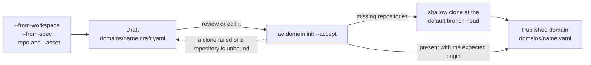
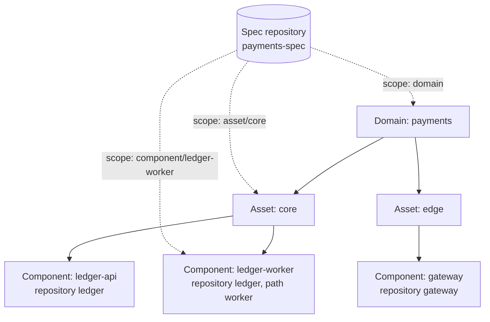
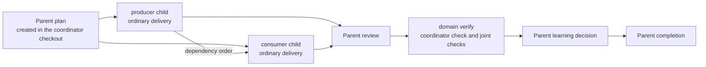

# Workspaces and multi-repository domains

Environment observations, workspace layout and delivery that spans several repositories.

## Optional environment observations

`ae inventory show --json` reads the selected Harness home's dated inventory cache. Missing cache creates no files. `ae inventory refresh --editor vscode|cursor|jetbrains --json` collects only the selected editor family and merges its bounded observations into that cache. It does not launch editors, install plugins, change settings or create profiles. Additional path overrides name metadata locations. An existing profile directory ID can narrow the observation; an unknown profile remains unknown. Dry-run collects and writes nothing.

Inventory records source paths and local scope. CLI-selected launcher paths do not identify a running instance. VS Code and Cursor extension enablement remains unknown; JetBrains disabled IDs can establish an explicit disabled observation. Approved settings are overrides with `effective_known: false`. Remote sessions and live capability remain uncollected. The collector avoids editor state databases and histories. A refreshed installation snapshot still requires a separate actual task-operation proof. Inventory is optional and is never scanned during ordinary Deliver orientation.

`ae orient` reports `layout` for the actual bound Git root, its `monorepo` or `product-repo` classification, and `projectStore` from the selected home and existing storage bindings. It does not search saved editor workspaces, probe neighboring repositories or prepare a domain draft. The compatibility fields remain `workspaceType: none`, `workspaceFile: null`, `roots: []` and `domainSuggestion: null`. A multi-repository task selects its actual repositories through explicit workspace/domain operations and task relevance; a folder list does not create scope or mandatory research. See [Workspace binding and task scope](workspace-layout-detection.md).

`ae domain show --name <name> --json` reads `<harness-home>/domains/<name>.yaml` without creating records or repairing drift. It reports expected identity separately from observed Git identity, checkout roots, worktree roots, HEAD, and checks-file presence. Missing or changed identities remain explicit. The original `domain_version: 1` shape remains readable. Its shared references are advisory, and its configuration cannot authorize delivery.

## Create a domain

A domain groups the repositories that make up one system: assets, each holding several components (microservices, workers, infrastructure), where a component is a whole repository or a folder inside one. Developers usually check out one component at a time, so the domain records how they belong together.

`ae domain init` creates a domain the way `ae init-repo` sets up a repository. It reads only the inputs you name, writes a draft for review, and publishes nothing until you accept it:

```bash
ae domain init --name payments --from-workspace ~/work/payments.code-workspace
ae domain init --name payments --from-spec /work/payments-spec --clone-root /work/payments
ae domain init --name payments --repo ledger=/work/ledger --repo gateway=https://example.invalid/pay/gateway.git --asset core=ledger,gateway
ae domain init --name payments --accept
```

- `--from-workspace` reads a VS Code `.code-workspace` file (comments and trailing commas allowed). Each folder that is a Git checkout joins with its origin and local path. AE still never looks for workspace files on its own; this one is used because you named it.
- `--from-spec` names a local checkout of the domain's spec repository. AE reads the repositories it declares from the first of `ae-domain.yaml`, `.ae/domain.yaml` or `docs/ae-domain.yaml`, from `repos` front matter, and from Markdown tables with a repository column in `README.md`, `architecture.md`, `docs/architecture.md`, `docs/architecture/index.md`, `prd.md`, `docs/prd.md` or `docs/prd/index.md`. Optional `asset`, `id`/`name`/`service` and `role` columns or keys place each repository. The spec repository itself becomes a source with a domain-level spec reference.
- `--repo id=<absolute path or URL>` and `--asset id=repo,repo` add repositories and group them directly. Inputs combine.

The draft lives at `<harness-home>/domains/<name>.draft.yaml`. It lists every repository, its binding, its asset and component, and the clones still needed. Edit it if you want, for example to point a repository at an existing checkout. `--accept` then clones each missing repository from the head of its default branch (`git clone --depth 1 --single-branch --no-tags`) into `--clone-root`, which defaults to the folder holding the spec repository, the workspace file or the first bound repository. Git uses your own configuration and credential helpers; prompts are disabled so an unattended run fails instead of waiting, and credential-bearing URLs are refused. Only the `https`, `http`, `ssh` and `git` transports are allowed for clones, and origins that name a Git remote helper (`::`) are refused. A clone target that already holds something other than that repository is left alone: init notes it, and the repository stays in the draft, unbound, until you set its binding there and accept again. Accept validates the result as a version 2 domain, refuses two repositories bound to the same checkout, requires every repository checkout to be present with the expected origin (a spec source with a different origin is reported as a warning), and writes `<harness-home>/domains/<name>.yaml`. If a clone fails or a repository is still unbound, the other repositories are published and the rest stay in the draft; rerun `--accept` to retry. Bindings published since the draft was written, for example by `ae domain bind`, win over the draft's copy. `git fetch --unshallow` restores full history in a clone you start working in.

Running `init` again with new inputs extends the pending draft, or the published domain when there is no draft, and keeps existing repository and source bindings; a checkout without an origin is recognised by its path. `--asset core=ledger,gateway` moves whole repositories into an asset, and a spec source whose asset or component scope no longer exists is dropped with a note. `ae domain bind --name payments --repo ledger=/work/ledger` points a repository (or `--source` a spec source) at another checkout; the checkout must have the expected origin. `--dry-run` shows either step without cloning or writing.



The domain lives in the selected Harness home beside each repository's knowledge, plans and configuration, never in a product or spec repository. Init and bind grant no trust and create no plans.

### Assets, components and spec sources

Version 2 domains accept two optional descriptive keys:

```yaml
assets:
  - id: core
    components:
      - { id: ledger-api, repo: ledger, role: service }
      - { id: ledger-worker, repo: ledger, path: worker, role: service }
spec_sources:
  - { source: payments-spec, scope: domain, include: [docs/domain/**] }
  - { source: payments-spec, scope: asset/core }
  - { source: payments-spec, scope: component/ledger-worker, authority: reference }
```



Dotted edges are spec sources. With the default `reference` authority they inform the Engineer and never block a gate.

Component IDs are unique across the domain and name a member repository, with an optional safe relative `path` and lowercase `role`. A spec source names a declared source, a `scope` of `domain`, `asset/<id>` or `component/<id>`, optional include patterns, and an `authority` of `reference` (the default) or `authoritative`. A reference spec informs the Engineer and never blocks a gate. Both keys stay out of the logical execution digest, so adding or editing them does not invalidate accepted domain plans; `shared_specs` remains the binding mechanism for parent plans. `ae domain show` reports them as `assets` and `specSources`.

## Shared intent and domain delivery

Executable domains require `domain_version: 2`. Logical descriptors identify each repository and shared-source repository by `origin` or an explicitly approved `local_identity: {id, approved: true}`. Machine-local absolute paths belong in `bindings`, separate from those descriptors. Unknown fields, duplicate IDs, and unsafe paths fail validation. Unavailable Git identities prevent execution. Origins cannot contain credentials. Two repository members cannot refer to the same physical Git repository. A source may share a repository's root.

This example describes two product repositories and shared intent stored in the producer repository:

```yaml
domain_version: 2
name: catalogue
repos:
  - id: producer
    origin: https://example.invalid/team/producer.git
  - id: consumer
    origin: https://example.invalid/team/consumer.git
sources:
  - id: contract
    origin: https://example.invalid/team/producer.git
bindings:
  repos:
    producer: /work/producer
    consumer: /work/consumer
  sources:
    contract: /work/producer
shared_specs:
  - source: contract
    path: docs/specs/catalogue.md
shared_conventions:
  - source: contract
    path: docs/conventions/catalogue.md
    authority: authoritative
```

Each shared spec binds its source ID, relative path, and SHA-256. A shared convention requires an explicit `authoritative` or `advisory` declaration. Only authoritative convention bytes are hashed as shared intent. The logical digest covers all declared membership and authority. The execution digest binds the resolved roots, Git directories, and directory identities. Harness records device, inode, and birth time so a replacement checkout at the same path cannot inherit the accepted identity. Missing stable directory identities prevent execution.

`C-shared-intent-sources` checks that binding alongside each child's ordinary in-repository `intent_sources`. Changed shared bytes, membership, source identity, or root authority invalidate the gate and proof. Editing the domain YAML does not accept that change. A revision-bound `amend` decision with a rationale and `authority.scope: domain-intent` can refresh `changes.domainBinding`, parent obligations through `changes.domainParent`, or a child's link through `changes.domainChild`. Parent and child amendments preserve their reserved IDs and paths. Refresh the parent first, then the affected child bindings and parent contract digests, before obtaining fresh gates and proof. Changing repository membership requires a fresh parent in this implementation.

The coordinator is the Git checkout from which the parent is created. The accepted parent binds that checkout's root, Git directories, physical directory identities, and initial HEAD. Parent mutation, review, gate, verification, and compounding reject another checkout before changing domain records, even if it has a same-named check. A coordinator or coordinator HEAD change requires an explicit `changes.domainParent.coordinator` amendment from the original physical coordinator after live identity validation. Read-only `show`, `status`, and `get` grant no mutation authority.

`ae domain plan-new --name <name> --file <decision.json> --json` accepts an authored full-plan decision. Its parent `scope` is empty. The decision must cover every configured repository in `repos`, with each entry's `id`, `scope`, and `depends_on`. A touched entry includes an authored `plan` containing its goal, slug, named check, acceptance criteria, and ordinary plan fields. An unchanged entry has an empty scope and no child plan. The parent also declares nonempty `joint_checks: [{repo, check}]`, a `release_order` covering every repository with dependencies first, and rollback responsibility in `rollback`. Its own `check` runs in the coordinator.

Configure those executable named checks through each repository's ordinary initialization workflow before creating the parent. Creation neither invents check stubs nor approves trust. If existing isolation policy blocks a touched primary checkout, Harness creates a linked issue worktree through the existing worktree operation. Returned child `workspace` values name the execution roots. A new root still needs the ordinary trust approval. Domain authority accepts a registered linked worktree of the bound repository; a same-origin foreign clone cannot substitute for it.

Parent plans live in `<harness-home>/domains/<name>/plans/`. Each touched repository receives one `.hplan` child in its ordinary external project plan store. The parent reserves all UUIDs and paths before publication. Creation replay preserves those identities and completed siblings; a different decision under the same operation ID conflicts. Schema 3 has exactly one `domain_parent` or `domain_child` contract plus `domain_binding`. Project commands cannot authorize a parent by its path alone. Ordinary child commands retain their scope, intent, isolation, trust, review, proof, learning, and completion checks.

The domain commands reuse those lifecycle operations with explicit parent authority:

| Command | Parent operation |
| --- | --- |
| `domain show --name <name>` | Read configuration and current identity observations. |
| `domain status --name <name> --plan <path>` | Project current child and joint-proof status without running checks. |
| `domain get --name <name> --plan <path>` | Read bounded parent bytes with `--offset`, `--lines`, and `--max-bytes`. |
| `domain plan-new --name <name> --file <decision>` | Reserve and create the parent and touched child records. |
| `domain plan-update --name <name> --plan <path> --file <decision>` | Apply authored start, amendment, progress, or completion decisions. |
| `domain gate --name <name> --plan <path> --phase implement` | Validate the accepted parent and publish its gate. |
| `domain review prepare --name <name> --plan <path> --base <base>` | Capture parent review sources and required coverage. |
| `domain review assemble --name <name> --plan <path> --packet <id> --file <results>` | Bind collected review results to that packet. |
| `domain verify --name <name> --plan <path> --base <base>` | Run the coordinator check and declared joint checks after child completion. |
| `domain compound --name <name> --plan <path> --learning-decision -` | Record accepted publication or no-learning for current parent proof, with the decision piped on stdin (a decision carrying `evidence_quote` is refused from a file). |



Use the same selected Harness home for the parent and its children. Run each child's ordinary delivery lifecycle in its returned workspace, in dependency order. Then collect parent review, run parent verification, record learning, and submit the complete decision. `domain status` is a derived rollup, not a second task lifecycle.

Joint checks run as trusted behavior checks in their declared repository contexts. Harness supplies `HARNESS_DOMAIN_REVISION_MANIFEST` with the exact participating roots, HEADs, bases, byte fingerprints, trust, shared bindings, and child completion identities. An unchanged dependency participates in that proof without an executable child. Passing local suites cannot replace the joint check. Harness checks the revision set and manifest before and after execution, preserves failed receipts, and reuses a successful joint receipt only while all its bindings remain current. A repaired consumer can retain an unchanged producer's valid completion. Merging and deployment remain separate actions.

Parent completion requires current child completion, joint proof, parent review, a finished learning decision, closed hard gaps, and completed parent tasks and criteria. Private parent learning publishes to `<harness-home>/domains/<name>/docs/solutions/` and builds the private domain index through the existing locked publication transaction. Ordinary project recall does not yet discover those episodes. Domain learning requires the explicitly authorized parent context.

The native Deliver tool stages inline domain decisions before execution. A successful domain operation with an explicit parent path selects that parent for the current run's completion check. Harness reloads it through explicit domain context and validates the accepted coordinator and current completion receipt. It does not discover a parent from ambient project state. Child runs retain ordinary project completion.

Extended plans use `.hplan` so the prior packaged CLI rejects them before mutation instead of treating new guarantees as ordinary Markdown. The current CLI requires authored file decisions for extended-plan updates. Explicit conversion of an ordinary schema 2 full plan to a domain child preserves its UUID. Its durable shared-project journal retains the accepted source and destination bytes, retires the `.md` path, then publishes the `.hplan`. Linked checkouts share the recovery guard. Interrupted conversion replays the recorded operation before further lifecycle updates. A parent is created through the domain command; copying fields into an ordinary plan does not grant parent authority. Keep CLI, corpus, and hooks on the matching release.

Conversion lookup preserves guards written under older Windows path spellings without rewriting them. It checks the current project's conversion catalog before permitting a new reservation or replay. Unknown or legacy missing journals, conflicting records, unreadable identities, and paths outside the approved plan stores block loading and mutation. A retired DOS-short basename whose long identity cannot be proved is ambiguous. An exact canonical reservation may resume before journal publication only when the rest of the catalog is valid and the authored operation matches its recorded input digest. The scan supports up to 256 retained guard files and 8 MiB of guard and journal content; exceeding either limit blocks plan loading for that project. There is no automatic guard deletion or migration.

Read-only guard lookup recognizes legacy plan stores in registered linked checkouts with the same physical common Git directory. Registration and `.git` backlinks must agree; a separate clone with the same origin or an unregistered copy does not qualify. This lookup admits at most 128 registered checkouts, bounds each metadata response to 64 KiB, and uses a shared four-second deadline. Mutation remains restricted to the invoking checkout's plan stores and its external project store.
