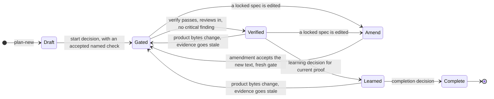

# Plans, gates and proof

What a plan records, how the implement gate and `ae verify` decide, and how hooks treat terminal commands. The overview is in [How Adaptive Engineering works](../adaptive-engineering.md).

## The plan lifecycle at a glance



A plan without an accepted named check stays a draft. Changing product bytes, the goal, criteria, scope or check mappings invalidates the evidence that depends on them, and under `content-v1` an edit to a locked spec invalidates the gate and the proof until an amendment accepts it. The sections below give the exact rules.

## Intent sources and isolation

Deliver is host-first. The Engineer works in the editor. Kernel-always means orient, plan lock, gate, and verify run in the Harness even when no extra agent is loaded. Orient names in-repo specs as `intentSources` and whether the checkout is isolated. The implement gate fails when those specs are missing from plan `intent_sources`, or when issue work is still on the default branch of the primary checkout. `ae worktree --slug` opens a linked worktree. A plan that exists only as an uncommitted `docs/plans` file or a gitignored `.harness/plans` file is copied into the project store. A later worktree run replaces that copy when the checkout file is newer and no plan-update holds the file, and leaves the store copy when the store file is newer. A worktree with no `origin` remote shares that store, so the same `--plan` still resolves. A checkout created with `git init --separate-git-dir` keeps its own store. `.gitignore` is not followed when it is a symlink. Orient and `plan-new` share one selection for the same text. A non-empty `intent_sources` list is frozen. The implement gate requires those paths and does not rank again. An empty list in a repo that has a spec still fails and names the selection. Plan lock records `{ path, sha256 }` of the file bytes for each readable in-checkout `intent_sources` file on that tip. A symlink or a missing file fails the lock instead of hashing something outside the checkout or saving a path with no hash. `ae prepare` publishes a missing starter with an exclusive create, so a file that appears during the write is left as it is. Under content-v1, a later edit to a selected source invalidates its gate and proof until an explicit amendment accepts the reviewed bytes. Harness records old/new hashes, rationale, declared authority scope, and affected evidence. A relock preserves the frozen selection and cannot silently rehash it. Legacy plans retain their paths-only guarantee until deliberately migrated. If shipped behavior contradicts a locked spec, update that spec in the same PR or a stacked PR. Do not rewrite the spec from the code in silence. Ambiguous specs become `needs-info` questions, not guesses. Agent-optional means a specialist is consulted only when the task needs that judgment. Benchmark-test-only means the unattended agent loop is for a measured eval, not for normal delivery.

## Structured workflow

The host-first path uses the same structured workflow snapshot in orientation, status, plan creation and plan updates. It supplies the current plan path and revision, partial decision arguments and evaluated or unknown prerequisites. Candidate decisions grant no authority; the existing transition validators and mutation hooks remain authoritative. The model still interprets intent and chooses implementation details. A short role prompt does not establish a separate deterministic controller.

Managed plans, including readable legacy plan roots, are written through AE decisions. Native editor and shell writes to those roots, aliases and ambiguous hardlinked files are refused. Supported host prompt events record session-bound observations using prompt digests rather than storing prompt text. A successful start, amendment or bookkeeping decision explicitly reconciles the observed request with the resulting plan revision. A later request remains pending even when an older decision is replayed. Completion cannot accept pending intent. Absent host events are reported as unobserved; neither query text nor generated hook files establish native qualification.

VS Code configuration registers the existing structured AE tools using a workspace variable at startup, preserving Default Permissions and other MCP servers. A running server stays bound to its original checkout. Opening or handing off to a worktree and authorizing a server remain host operations. Configured assets and source-level tests do not prove live editor or cross-model behavior.

## Optional headless delivery

The optional headless Deliver loop uses the same mutation hooks and completion authority. It requires `orient --read --query` with touched files before product edits and checks bound completion when the model tries to finish. Its lifecycle tool accepts authored decisions for planning, review assembly and compounding. A failed or missing proof cannot become a successful final message. The separate autonomous profile keeps its task-verifier contract and does not acquire the Deliver lifecycle.

Orient shows trust, constraints, acceptance criteria, review coverage and an implement-only gate preview. With no explicit file list it derives the change neighborhood from the selected plan scope. The compact pack removes repeated plan paths and optional prose before the work contract; an oversized contract creates an explicit context-read barrier. `orient --read --plan <path>` returns the contract and neighborhood without pack truncation. Finalize eval check and routing files before the person approval that pins them. An agent edit of pinned policy invalidates that approval.

## What a plan must contain

A new ordinary full delivery plan uses `plan_schema: 2`; a new short plan uses `short-v2`. Both declare `intent_source_policy: content-v1`. Domain parents and children use full `plan_schema: 3` records with the `.hplan` extension. Short plans do not acquire domain authority. Verification names trusted checks and maps each criterion to proof. Required review coverage remains explicit. Without an accepted named check the plan stays an unlocked draft. Legacy `plan_schema: 1` and `short-v1` remain readable with their declared paths-only source guarantee until explicit migration.

```yaml
plan_schema: 2
intent_source_policy: content-v1
intent_sources: []
verification:
  required: [behavior]
  criteria: {AC1: [behavior]}
reviews:
  required: [code-review]
  completed: []
  critical_open: []
```

Product plans list `code-review` in `reviews.required`. A docs plan may leave that list empty. `ae review prepare --plan <path> --base <base> --json` captures the work to review. The host invokes reviewers, then `ae review assemble --plan <path> --packet <id> --file <results.json> --json` validates and stores their results. Configured adaptive review requires the complete native provider response observed by the adapter and bound to the packet, source, policy and actual session. An authored `provenance: host-invocation` or Engineer same-context review cannot supply that evidence. Existing unconfigured installations retain their declared-invocation compatibility contract; that declaration does not authenticate a host invocation. `ae verify` fails while required collected coverage is incomplete or critical findings remain. A bare completed string is not review evidence.

The Engineer runs review preparation and assembly. The coordinator receives the prepared packet, dispatches its required judgments, and returns raw results with their actual status. It has no terminal execution authority. Focused TDD checks run during implementation. Required review and authoritative `ae verify` follow the completed change. README edits use a proportional full docs plan and the same gate, proof, learning, and completion authority.

Document review accepts regular Markdown files from the current project's external plan store, including unlocked drafts. Each packet binds the exact absolute path and source hash. Explicit files in a standalone document review use `selected-document-v1` scope, binding only the selected regular sources, governing policy and trust, document criteria, and findings schema. The packet deliberately has no product diff, and findings must name a captured source. Preparation and assembly recheck source and governing-input freshness; assembly rederives the current project store and rejects changed, missing, symlinked, or unrelated sources. Plan-bound reviews and document reviews without explicit files retain broad product scope, as do existing untagged packets. Selected document review cannot satisfy delivery review obligations. A valid draft or collected review does not accept the plan or authorize implementation. Accepted plan changes use revision-bound decisions.

Supply semantic creation and amendment inputs through `ae plan-new --file` and `ae plan-update --file`. Harness owns headings, dates, criterion/task IDs, source bindings, progress, counts, and activity. A start decision validates readiness and scope, locks the resulting state, and binds the implement gate as one recoverable operation. Repeated operation IDs reuse the same accepted result; different payloads or stale revisions conflict. Author reasoning through note fields rather than constructing plan templates. See the shipped `skills/references/plan-operations.md` contract.

Full creation decisions accept `skillsUsed` for skills actually loaded. Primitive maintenance requires a `create-primitive` declaration. The declaration does not replace the successful skill read recorded for the current session. Decision inputs belong under `.harness/decisions/`; Harness owns the other lifecycle state files.

After verification, pipe a publish or no-learning decision to `ae compound --plan <path> --learning-decision - --json` (a decision carrying `evidence_quote` is refused from a file), then a complete plan-update decision. Completion version 2 requires a finished learning decision for current proof and completed tasks across all phases. Missing, pending, blocked, changed, or stale learning records prevent completion. No-learning creates no episode. The Stop hook validates current bound completion on every attempt. Progress and other bookkeeping do not change the work contract. Goal, criteria, scope, check mappings, policy, product bytes, selected intent bytes under content-v1, and execution phase still invalidate relevant evidence.

Captures and standalone index rebuilds share a lock on the physical knowledge manifest. A capture holds it through episode publication, retrieval snapshots, index rebuilding, and any rollback. Concurrent captures cannot replace a sibling's newer index or restore a snapshot over a successful sibling publication. Dry runs acquire no lock and write nothing.

Ordinary evidence uses version 5. Domain evidence uses version 6 to bind shared authority, participating revisions, child completion, and joint proof. Old proof requires re-verification when its format cannot enforce the current contract. Upgrade the CLI, corpus, and installed hooks together. Verification observations, review packets, learning operations, and completion records remain under `.harness/`. A lost final status write is recoverable by retrying the completion command.

Installed hooks resolve the hydrated CLI directly under `~/.copilot/.ae-bin/`. A global PATH entry is optional. Episode writers publish complete bytes atomically with exclusive creation; interruption before publication leaves the final name absent, and replay reuses an identical published episode. Review records enforce the same 1 MiB limit at write and read boundaries before changing the current coverage pointer.

Workflow activation records bind an actual complete read to the selected installed or bundled source path and SHA-256. A matching filename, a successful partial range, a decoy workspace file or stale bytes cannot satisfy that observation. Supported native envelopes and the existing headless Deliver reader preserve their own evidence; neither authenticates a host transcript. Older unbound activation records require a genuine reread.

`ae status --effective-policy --json` reports the CLI policy authority, rule-specific modes, positive freshness limits, trust binding, and resolver version. Installed hooks refresh that snapshot when source bytes, trust, or environment change. An unavailable or invalid authority fails closed. A command override is scoped to its invocation and is never cached as a hook policy.

Named checks are argv arrays in the selected project `checks.yaml`; `ae checks list --json` reports its exact path. The Harness runs them without a shell. Policy exemptions and waivers are explicit. A missing check is not a pass.

A named check may declare an `artifacts` list of explicit relative JSON filenames. The runner supplies a unique invocation directory under `.harness/evidence/check-artifacts/` through `HARNESS_CHECK_ARTIFACT_DIR`. It accepts at most 16 JSON objects of at most 1 MiB each, then stores redacted bytes and records their paths, byte lengths, and SHA-256 hashes. Missing output, malformed JSON, unsafe paths, symlinks, and nonregular files fail the check. Evidence validation rereads required artifacts and rejects changed or missing bytes. Concurrent invocations cannot overwrite one shared latest file. Artifact presence never replaces the helper's behavioral assertion and exit result. Checks without declarations retain their existing output guarantee.

Terminal hooks recognize a bounded set of read commands and explicit writes. Scripts, inline runtimes, package commands and ambiguous shell syntax are opaque. Opaque execution requires a fresh implement gate, current project trust and exact argv agreement with a required named check in the locked plan. Wrappers, command expansion and extra invocations cannot inherit that permission. This policy checks declared commands; it does not inspect script behavior or sandbox the process. Any potentially mutating terminal attempt leaves verification pending, including a failed command that may already have written files. Decision inputs have a contained, nonsymlink exception under `.harness/decisions/`; other lifecycle files remain guarded.

A standalone canonical `ae worktree --slug` can establish isolation before an implement gate, including recovery after a failed gate. Its CLI validation remains authoritative; wrappers, redirection and mixed commands retain their normal gate requirements. Bootstrap disables Git hooks and filesystem monitors, creates the worktree without checking out files, then resolves filter configuration in that checkout before populating raw committed bytes. This also suppresses filters enabled only by the target branch or Git directory. Unreadable helper metadata fails closed; a newly created checkout that cannot be populated is removed so a retry cannot accept an empty worktree. Configured filters, including Git LFS, do not run during bootstrap, so their committed pointer files remain raw. Ripgrep queries with `RIPGREP_CONFIG_PATH` set are opaque unless the first argument is `--no-config`, which unambiguously disables that configuration. Option text used as a pattern or filename grants no exemption. Explicit `--pre` or `--hostname-bin` options remain opaque even with `--no-config`.

Git query admission checks effective helper configuration through an uncached, bounded metadata read. Executable or unresolved query effects remain opaque. Authoritative product diffs and scope reads disable configured filesystem monitors, diff conversion and filter helpers through per-invocation options, without changing repository configuration. These reads use raw content and fail closed when helper metadata cannot be resolved; they do not provide a general Git sandbox.

Git grep pager options remain opaque, including combined short flags and abbreviated long-option spellings. Ordinary grep queries remain read-only.

Named-check evidence retains at most 4,000 characters per stream, split between the beginning and end, with omitted-character counts. A stream observer checks secrets before truncation. Detected private-key streams and other secret-bearing truncated streams are suppressed; other intact excerpts are redacted before ledger and evidence publication. Default runner capture and raw live callbacks retain their existing contracts. The bounded evidence is an excerpt, and unknown secret formats remain outside the detector's guarantee.

Skill-first means a repeated procedure becomes a skill before it becomes another agent. The Engineer can start with no domain skill and no specialist. Those are acquired later. Before a product edit whose shape is not already the local pattern, the Engineer loads `/architect`.

Agent bodies target 10-20 lines, excluding YAML metadata. Keep role boundaries, judgment criteria, input safety, and output responsibility in the agent. Prefer deleting repeated procedures and sample reports over moving the same text into another file. The source contracts cap bodies at 20 lines and estimate the whole file at no more than 600 tokens for specialists or 900 for the Engineer. These are local authoring budgets, not measured quality or latency improvements. Preserve readable sentences and validate task behavior before claiming a semantic improvement.

When a caller supplies a review packet and findings schema, that contract takes precedence over a specialist's standalone report format. Keep the schema in the existing review skill. Preserve actual failed or partial results through the coordinator and leave final judgment with the Engineer.

## Deterministic extraction release

The deterministic extraction release packages the CLI, corpus and installed hooks together. Read the current release version from `packages/ae/package.json`. Upgrade the built package and hydrate the same version before consuming the full/short plan contracts. Legacy plans keep their declared guarantee until explicit migration; do not describe paths-only evidence as content-bound. Preserve journals and raw records across rollback, and retain the Phase 1 false-success repairs. A reviewed candidate is separate from a published package or verified editor installation.

The remaining boundary is decision input: the Engineer chooses intent, scope, check adequacy, defect judgment, research integration, capability need and promotion. Harness owns serialization, discovery, exact matching, counts, policy, transitions, execution, provenance and bounded facts. Research and brainstorming submit authored plan notes instead of dated YAML templates. Imported conventions use resource scaffolding and shared validation. Encountered gaps use new revision-bound declarations; only a hard plan-scope declaration blocks the whole plan, while all unresolved hard gaps prevent passed proof.

Use `report --facts` for source-bound inventory, versions, declared graphs, coverage and completion facts. Declared delegation is separate from inferred architecture and installed capabilities. Retrieve source records when output reports omissions. A historical passed string never substitutes for current proof.

`orient --read` also advertises `graph deps`, `graph dependents` and `graph path`
for bounded file dependency queries. These commands use current tracked
worktree content and qualified import resolution. They expose extraction tiers,
unknown coverage, limits and snapshot receipts; they do not establish exact
runtime calls or change plan authority. Structural extraction is cached in
immutable, hash-checked JSON generations under the per-worktree Harness home.
Readers select one generation, and source drift refuses publication. See
[repository dependencies](structural-knowledge.md#repository-dependencies)
for query and storage contracts.

The Harness Doctor skill ships an installed product-proof entry and feature-map example. Its clean-package synthetic journey proves executable delegation and broken/fixed enforcement; a selected real product, agreed disposable flow and actual editor invocation need separate evidence. See the shipped `skills/references/installed-product-proof.md`.

The development-only mechanical evaluator runs repeated regression fixtures with actual observed CLI/hook calls, bytes and wall time. It does not run a model or measure semantic quality, tokens or agent intervention. Those limits must accompany any workflow-improvement claim.

## Bounded intent discovery

Orient preserves selected intent paths and reports candidate, selected and omitted counts, joined-line bytes and truncation. Compact discovery has eight paths and 512 bytes, including the first path. Intent may exist even when no path fits. Use `ae orient --read --intent-page 1 --intent-page-size 8 --json` to review exact paths from a bounded page. A locked source set stays frozen while new candidates remain visible.

A nonempty explicit creation selection is exact. An authored `amend` decision may replace it with `intentSelection: {previous: [{path, sha256}], next: [path]}`. It requires the observed revision, a rationale and `authority.scope: plan-intent`. Harness validates the previous set, hashes the accepted next set and records additions and removals. Relock preserves accepted hashes.

## Durable playbook worklists

New plans receive a stable CLI-owned `plan_id`. An accepted playbook selection binds its scalar ID and source SHA-256 in `playbook_binding`. Creation may select `playbook`; existing plans use an authored `changes.playbook` amendment. A changed procedure requires a workflow amendment. Relock cannot replace a frozen procedure.

`ae todo sync --plan <path>` reads that accepted numbered procedure and reconciles its steps under the resolved project store. Replays preserve completed items. Linked worktrees share the plan's worklist. List creates no files. Malformed scoped records fail rather than resetting. Legacy unscoped `.harness/todo.json` remains separate.

Scoped complete records performed work. Accepted inapplicability belongs on the plan through `changes.workflowNotApplicable`, naming the playbook, hash, step and reason. Its advisory item stays open. Reports distinguish performed, accepted inapplicable and pending steps. Worklists never satisfy plan tasks or acceptance criteria.

## Caffeinated delivery continuation

Caffeinated is an internal experimental skill owned by developer-experience. Orient supplies its procedure read pointer only for an accepted Deliver plan with a current bound playbook. The Engineer reads the skill, accepted plan and exact playbook, then reconciles the scoped worklist. It follows applicable steps, uses focused tests between units, collects required review, runs authoritative named verification, compounds and records completion. Visible changes use the selected recipe and affected feature map. Corrections require current proof.

This is a contextual handoff within the Engineer's existing lifecycle. `ensure-plan` establishes missing prerequisites; Caffeinated does not choose intent or a playbook, classify intake again, lock independently or expand scope. Harness remains the only writer of worklist and lifecycle state. Answer, Investigate and review-only work do not load it. The public menu remains engineer, harness-doctor, project-readme and triage-issues; the Engineer agent and its token budget are unchanged.

After an actual read, a full plan records `caffeinated` through an authored `skillsUsed` amendment. Short plans use existing session/activity evidence. Declaration alone never proves activation. Follow the returned procedure pointers during ensure-plan continuation; missing or changed prerequisites return to planning and high uncertainty remains abstention.

The initial evidence concerns fragile handoffs exercised in four implementation units: drive cleanup and cancellation, preserved artifact integrity, explicit intent acceptance, and replay-safe worklist synchronization. Their passed verification receipts remain local research artifacts named `implementation/slice-1-verify-final.json` and `implementation/slice-2-verify.json` through `slice-4-verify.json`. This supports experimental packaging and continued evaluation, not a measured model benefit. [Caffeinated fixtures](../../packages/ae/test/caffeinated.test.mjs) cover activation and confusable prompts; [Deliver runtime fixtures](../../packages/ae/test/agent-delivery.test.mjs) check actual read provenance and lifecycle enforcement. Structural tests and CLI fixtures remain separate from a model outcome eval.

The catalog-search eval is run after implementation on the completed checkout with the same seeded paragraphs and judges for both arms. It continues pass 2 on pass 1's trees and judges the runner's workspace; a fix left in a side worktree does not pass. macOS CLI evidence does not establish native editor activation. The interactive Windows product/editor pilot was waived because no environment is available; native VS Code and IntelliJ behavior remains unverified. Headless Windows CLI regression remains required. Promotion to active use requires outcome evidence and human governance.
